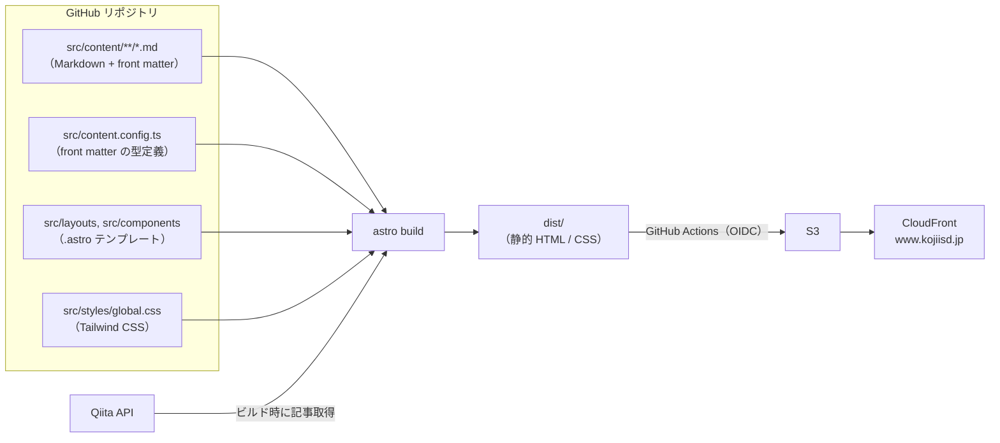
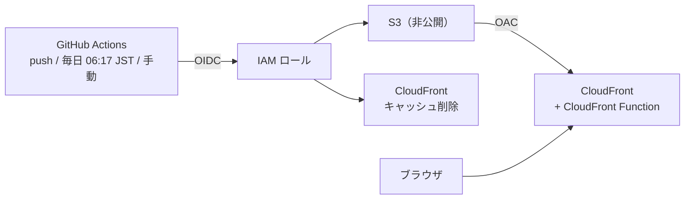

# web-kojiisd

[https://www.kojiisd.jp/](https://www.kojiisd.jp/) のソースコードです。
kojiisd のポートフォリオサイトを、構造も含めてオープンにしています。

- コンテンツはすべて **Markdown** で管理
- **Astro** で静的HTMLにビルド
- **S3 + CloudFront** で配信（インフラは `infra/` の **AWS CDK** で定義）
- **GitHub Actions** でビルド・デプロイ（`master` への push と毎日の定期実行）

## 仕組み



### 1. Markdown を読み込む（Content Collections）

Astro は Markdown を標準でサポートしています。`src/content.config.ts` で「どのフォルダの Markdown を、どんな front matter で読むか」を定義すると、Astro がそれを **コレクション** として扱います。

```ts
// src/content.config.ts
import { defineCollection } from "astro:content";
import { glob } from "astro/loaders";
import { z } from "astro/zod";

const works = defineCollection({
  loader: glob({ pattern: "**/*.md", base: "./src/content/works" }),
  schema: z.object({
    title: z.string(),
    summary: z.string(),
    date: z.coerce.date(),
    tags: z.array(z.string()).default([]),
    draft: z.boolean().default(false),
  }),
});

export const collections = { works };
```

（実際の定義は `site`（見出しとリンク）/ `works`（成果物）の2コレクションです）

front matter に `title` が無い、`date` の書式が違う、といった誤りは **ビルドエラー** になるため、壊れたページが公開されることはありません。

### 2. テンプレートに流し込む

ページは `src/pages/` 配下のファイル名がそのまま URL になります（`src/pages/index.astro` → `/`）。
テンプレート側でコレクションを取得し、Markdown 本文は `<Content />` として埋め込みます。

```astro
---
// src/pages/works/[slug].astro
import { getCollection, render } from "astro:content";
import BaseLayout from "../../layouts/BaseLayout.astro";

export async function getStaticPaths() {
  const works = await getCollection("works", ({ data }) => !data.draft);
  return works.map((work) => ({ params: { slug: work.id }, props: { work } }));
}

const { work } = Astro.props;
const { Content } = await render(work);
---
<BaseLayout title={work.data.title}>
  <h1>{work.data.title}</h1>
  <article class="prose">
    <Content />
  </article>
</BaseLayout>
```

`---` で囲まれた部分はビルド時に実行される TypeScript、その下が出力される HTML です。ブラウザに JavaScript は送られません。

### 3. スタイル（CSS）を当てる

スタイルは3つの層で当てています。

| 対象 | 方法 | 場所 |
|---|---|---|
| サイト全体（色・フォント・余白） | Tailwind CSS のユーティリティクラス | `src/styles/global.css`、各 `.astro` |
| Markdown 本文（見出し・リスト・コード） | `@tailwindcss/typography` の `prose` クラス | 本文を囲む要素に `class="prose"` |
| 特定の部品だけ | `.astro` 内の `<style>`（自動でその部品だけに適用される） | 各 `src/components/*.astro` |

Markdown から生成される HTML（`<h2>` や `<ul>`）にはクラスが付きません。そのため本文は `prose` で囲み、まとめて整形しています。Markdown 側に CSS を書く必要はありません。

```css
/* src/styles/global.css */
@import "tailwindcss";
@plugin "@tailwindcss/typography";
```

## ディレクトリ構成

```
web-kojiisd/
├── astro.config.mjs          # サイトURL、Tailwind などの設定
├── package.json
├── .nvmrc                    # Node.js のバージョン（GitHub Actions でも使用）
├── .github/workflows/        # サイトのビルド・デプロイ（deploy.yml）、インフラのチェック（infra.yml）・反映（infra-deploy.yml）
├── infra/                    # AWS CDK（S3、CloudFront、ACM、Route 53、デプロイ用 IAM ロール）
├── .env.example              # 環境変数のサンプル
├── public/                   # そのまま配信されるファイル（favicon、画像）
└── src/
    ├── content.config.ts     # コレクションと front matter の型定義
    ├── content/              # ★ コンテンツ（Markdown）
    │   ├── site.md           #   トップの見出しとリンク（GitHub / Qiita / X など）
    │   └── works/            #   成果物（1件 = 1ファイル、画像も同じ場所に置ける）
    ├── lib/
    │   └── qiita.ts          # ビルド時に Qiita API から記事を取得
    ├── components/           # タイルなどの部品（LinkTiles, WorkTiles, ArticleTiles）
    ├── layouts/
    │   ├── BaseLayout.astro  # <head>、OGP、Google Analytics
    │   └── MarkdownLayout.astro  # Markdown で書いたページ用
    ├── pages/                # ルーティング（ファイル名 = URL）。.md を置けばページになる
    │   ├── index.astro
    │   ├── 404.astro
    │   └── works/[slug].astro
    └── styles/
        └── global.css
```

## コンテンツの更新

HTML を書く必要はありません。編集するのは Markdown だけです。

| やりたいこと | 編集するファイル |
|---|---|
| 見出し・リンクを変える | `src/content/site.md` |
| 成果物を追加する | `src/content/works/` に `.md` を追加 |
| ページを追加する | `src/pages/` に `.md` を追加 |
| Qiita の記事 | 編集不要（ビルド時に最新 9 件を自動取得） |

### 成果物を追加する

`src/content/works/<好きな名前>.md` を作ります。

```markdown
---
title: kintone 連携ツール
summary: タイルに表示される1〜2行の説明
date: 2025-04-01
tags: [kintone, AWS]
url: https://github.com/kojiisd/xxx   # 任意。指定するとタイルから直接このURLへ飛ぶ
cover: ./images/kintone-tool.png       # 任意。タイルに出す画像（このファイルからの相対パス）
---

url を指定しない場合は、ここに書いた本文が詳細ページ（/works/<ファイル名>/）になります。
```

- `draft: true` を付けると公開されません。書きかけのまま push して構いません。
- 画像は `src/content/works/images/` などに置きます。ビルド時に WebP へ変換され、サイズも最適化されます。
- 公開中の成果物が 1 件もない場合、Works の欄は表示されません。

### ページを追加する

`src/pages/<URL にしたい名前>.md` を作ります。たとえば `src/pages/talks.md` は `/talks/` になります。

```markdown
---
layout: ../layouts/MarkdownLayout.astro
title: 登壇資料
---

## 2025年
- [〇〇勉強会](https://speakerdeck.com/...)
```

1 行目の `layout` は決まり文句で、ヘッダー・フッターと文章の見た目を付けるためのものです。

### 更新の流れ

1. GitHub の Web 画面（または手元）で Markdown を編集・追加する
2. `master` にコミットする（PR を経由しても可）
3. GitHub Actions が自動でビルド・デプロイし、1〜2 分で https://www.kojiisd.jp/ に反映される

front matter の書き間違い（`date` の書式など）はビルドエラーになり、その場合はデプロイされません（公開中のサイトはそのまま残ります）。

## ローカル開発

Node.js（バージョンは `.nvmrc` を参照）が必要です。

```sh
npm install
npm run dev      # http://localhost:4321 で確認（保存すると即反映）
npm run build    # 型チェック（astro check）後、dist/ に静的ファイルを出力
npm run preview  # ビルド結果を確認
```

## デプロイ



`.github/workflows/deploy.yml` が `npm run build` の結果を S3 に同期し、CloudFront のキャッシュを削除します。
AWS の認証には OIDC を使うため、アクセスキーを GitHub に保存していません。

| ホスト | 挙動 |
|---|---|
| `www.kojiisd.jp` | 正規ホスト（サイト本体） |
| `kojiisd.jp` | `www.kojiisd.jp` へ 301 リダイレクト |
| `web.kojiisd.jp` | `www.kojiisd.jp` へ 301 リダイレクト（旧 URL） |

リダイレクトとディレクトリ URL の解決（`/works/example/` → `index.html`）は、CloudFront Function（`infra/functions/viewer-request.js`）で行っています。

### GitHub の設定

| 名前 | 種類 | 内容 |
|---|---|---|
| `AWS_DEPLOY_ROLE_ARN` | Variables | CDK の出力 `DeployRoleArn`。未設定の間はビルドのみ行い、デプロイしない |
| `S3_BUCKET` | Variables | CDK の出力 `BucketName` |
| `CLOUDFRONT_DISTRIBUTION_ID` | Variables | CDK の出力 `DistributionId` |
| `AWS_INFRA_ROLE_ARN` | Variables | CDK の出力 `InfraDeployRoleArn`。「Deploy infra」ワークフローで使用 |
| `PUBLIC_GA_ID` | Variables | Google Analytics 4 の測定ID（`G-...`）。未設定ならタグを出力しない |
| `QIITA_TOKEN` | Secrets（任意） | Qiita API のアクセストークン。未認証だと 60回/時 の制限あり |

Qiita API の取得に失敗してもビルドは止まらず、記事一覧のセクションが非表示になるだけです。
なお、GitHub はリポジトリに 60 日間更新がないと定期実行を自動で無効化します。その場合は Actions の画面から再度有効化してください。

### インフラ

構築手順と、Amplify Hosting からの切り替え手順は [infra/README.md](infra/README.md) を参照してください。

## Hugo 版からの対応

2019〜2022年は Hugo で運用していました（Git 履歴に残っています）。

| Hugo | Astro |
|---|---|
| `content/*.md` | `src/content/**/*.md` |
| front matter | front matter（型チェックあり） |
| `layouts/`、`themes/` | `src/layouts/`、`src/components/` |
| `static/` | `public/` |
| `config.toml` | `astro.config.mjs` |
| `hugo server` | `npm run dev` |
