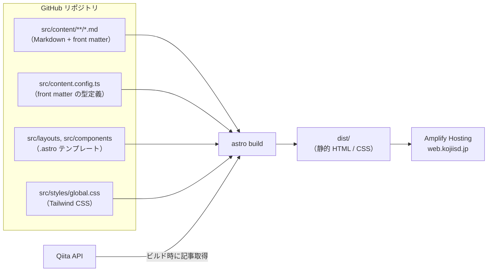

# web-kojiisd

[https://web.kojiisd.jp/](https://web.kojiisd.jp/) のソースコードです。
kojiisd のポートフォリオサイトを、構造も含めてオープンにしています。

- コンテンツはすべて **Markdown** で管理
- **Astro** で静的HTMLにビルド
- **AWS Amplify Hosting** で配信（`master` への push で自動デプロイ）

## 仕組み



### 1. Markdown を読み込む（Content Collections）

Astro は Markdown を標準でサポートしています。`src/content.config.ts` で「どのフォルダの Markdown を、どんな front matter で読むか」を定義すると、Astro がそれを **コレクション** として扱います。

```ts
// src/content.config.ts
import { defineCollection } from "astro:content";
import { glob } from "astro/loaders";
import { z } from "astro/zod";

const works = defineCollection({
  loader: glob({ pattern: "**/*.md", base: "./src/content/works" }),
  schema: z.object({
    title: z.string(),
    summary: z.string(),
    date: z.coerce.date(),
    tags: z.array(z.string()).default([]),
    draft: z.boolean().default(false),
  }),
});

export const collections = { works };
```

（実際の定義は `profile` / `works` / `career` の3コレクションです）

front matter に `title` が無い、`date` の書式が違う、といった誤りは **ビルドエラー** になるため、壊れたページが公開されることはありません。

### 2. テンプレートに流し込む

ページは `src/pages/` 配下のファイル名がそのまま URL になります（`src/pages/index.astro` → `/`）。
テンプレート側でコレクションを取得し、Markdown 本文は `<Content />` として埋め込みます。

```astro
---
// src/pages/works/[slug].astro
import { getCollection, render } from "astro:content";
import BaseLayout from "../../layouts/BaseLayout.astro";

export async function getStaticPaths() {
  const works = await getCollection("works", ({ data }) => !data.draft);
  return works.map((work) => ({ params: { slug: work.id }, props: { work } }));
}

const { work } = Astro.props;
const { Content } = await render(work);
---
<BaseLayout title={work.data.title}>
  <h1>{work.data.title}</h1>
  <article class="prose">
    <Content />
  </article>
</BaseLayout>
```

`---` で囲まれた部分はビルド時に実行される TypeScript、その下が出力される HTML です。ブラウザに JavaScript は送られません。

### 3. スタイル（CSS）を当てる

スタイルは3つの層で当てています。

| 対象 | 方法 | 場所 |
|---|---|---|
| サイト全体（色・フォント・余白） | Tailwind CSS のユーティリティクラス | `src/styles/global.css`、各 `.astro` |
| Markdown 本文（見出し・リスト・コード） | `@tailwindcss/typography` の `prose` クラス | 本文を囲む要素に `class="prose"` |
| 特定の部品だけ | `.astro` 内の `<style>`（自動でその部品だけに適用される） | 各 `src/components/*.astro` |

Markdown から生成される HTML（`<h2>` や `<ul>`）にはクラスが付きません。そのため本文は `prose` で囲み、まとめて整形しています。Markdown 側に CSS を書く必要はありません。

```css
/* src/styles/global.css */
@import "tailwindcss";
@plugin "@tailwindcss/typography";
```

## ディレクトリ構成

```
web-kojiisd/
├── astro.config.mjs          # サイトURL、Tailwind などの設定
├── amplify.yml               # Amplify Hosting のビルド設定
├── package.json
├── .nvmrc                    # Node.js のバージョン（Amplify でも使用）
├── .env.example              # 環境変数のサンプル
├── public/                   # そのまま配信されるファイル（favicon、画像）
└── src/
    ├── content.config.ts     # コレクションと front matter の型定義
    ├── content/              # ★ コンテンツ（Markdown）
    │   ├── profile.md        #   自己紹介・肩書き・リンク・資格
    │   ├── works/            #   実績（1件 = 1ファイル）
    │   └── career/           #   経歴（1件 = 1ファイル）
    ├── lib/
    │   └── qiita.ts          # ビルド時に Qiita API から記事を取得
    ├── components/           # セクション単位の部品（Hero, Works, Career, QiitaArticles など）
    ├── layouts/
    │   └── BaseLayout.astro  # <head>、OGP、Google Analytics
    ├── pages/                # ルーティング（ファイル名 = URL）
    │   ├── index.astro
    │   └── works/[slug].astro
    └── styles/
        └── global.css
```

## コンテンツの更新

更新するのは基本的に `src/content/` の Markdown だけです。

| やりたいこと | 編集するファイル |
|---|---|
| 自己紹介・肩書きを変える | `src/content/profile.md` |
| 資格・スキル・リンクを追加する | `src/content/profile.md` の front matter |
| 実績を追加する | `src/content/works/` に `.md` を追加 |
| 経歴を追加する | `src/content/career/` に `.md` を追加 |
| Qiita 記事一覧 | 編集不要（ビルド時に自動取得） |

実績・経歴は `draft: true` の間は公開されません。書きかけは `draft: true` のまま push して構いません。
公開済みの実績・経歴が1件もないセクションは表示されません。

例：`src/content/works/genai-service.md`

```markdown
---
title: 生成AIを組み込んだ〇〇サービス
summary: 一覧に表示される1〜2行の説明
date: 2025-04-01
tags: [AWS, Bedrock, Serverless]
draft: false
---

## 概要
本文は普通の Markdown で書きます。
```

## ローカル開発

Node.js（バージョンは `.nvmrc` を参照）が必要です。

```sh
npm install
npm run dev      # http://localhost:4321 で確認（保存すると即反映）
npm run build    # 型チェック（astro check）後、dist/ に静的ファイルを出力
npm run preview  # ビルド結果を確認
```

## デプロイ

AWS Amplify Hosting がリポジトリと連携しており、`master` に push すると `amplify.yml` に従ってビルド・公開されます。

| 設定 | 場所 | 内容 |
|---|---|---|
| `PUBLIC_GA_ID` | Amplify の環境変数 | Google Analytics 4 の測定ID（`G-...`）。未設定ならタグを出力しない |
| `QIITA_TOKEN` | Amplify の環境変数（任意） | Qiita API のアクセストークン。未認証だと 60回/時 の制限あり |
| 定期ビルド | EventBridge Scheduler → Amplify の Webhook | Qiita の新着記事を毎日反映 |

Qiita API の取得に失敗してもビルドは止まらず、記事一覧のセクションが非表示になるだけです。

## Hugo 版からの対応

2019〜2022年は Hugo で運用していました（Git 履歴に残っています）。

| Hugo | Astro |
|---|---|
| `content/*.md` | `src/content/**/*.md` |
| front matter | front matter（型チェックあり） |
| `layouts/`、`themes/` | `src/layouts/`、`src/components/` |
| `static/` | `public/` |
| `config.toml` | `astro.config.mjs` |
| `hugo server` | `npm run dev` |
